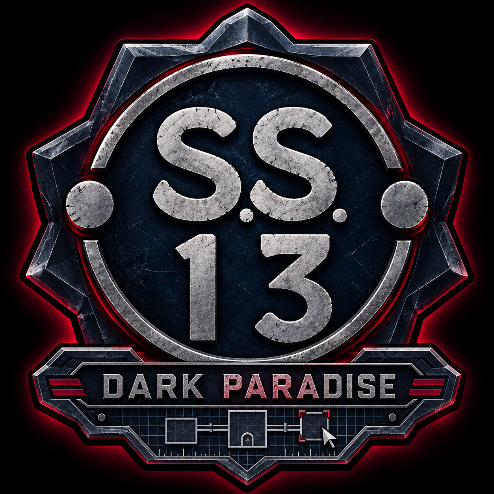

<p align="center">
  
</p>

# DarkDMM

DarkDMM — экспериментальное ответвление редактора карт [StrongDMM](https://github.com/SpaiR/StrongDMM) для BYOND/SS13
с русским интерфейсом, синей темой и инструментами, которых не хватало при маппинге.

Отдельно от оригинала: другая папка настроек и нет автообновления, так что DarkDMM можно держать рядом со StrongDMM.

## Что добавлено

**Освещение**

* Предпросмотр освещения на карте и на скриншотах (`Ctrl+L`).
* Две модели света: TG/Paradise и Baystation (Foundation-19 и похожие сборки) — падение света, питание зон от APC, свет через open space.

**Инструменты**

* «Разброс» — ставит объекты с заданным шансом в области, удобно для леса и мусора.
* «Прокладка» — кабели, атмос-трубы и мусоропровод с нужными стыками и развилками.
* Поворот и отражение выделения с учётом направлений, кабелей и труб.
* Замена одного объекта на любой другой (`Ctrl+H`).
* Шаблоны из выделения (`Ctrl+T`).
* Поиск по переменным объектов: тип с подтипами, переменная, значение.

**Доступы и маршруты**

* Окно доступов объекта: отдел, название, включение и выключение доступов.
* Карта маршрутов: куда можно дойти с выбранными доступами.

**Проверка карты**

* Встроенный линтер (`F7`, при открытии и после сохранения) читает правила из самого билда: `tools/maplint`, `check_grep.py`, `test/run-test.sh`.
* Для Baystation-сборок перенесены статические юнит-тесты карт. Они только предупреждают и сохранению не мешают.

**Надёжность**

* Автосохранение копий карт, при аварийном завершении несохранённые карты записываются в `backup/crash`.
* Исправлены утечки памяти и вылеты оригинала, ускорена загрузка.
* Анимированные иконки на карте.

## Настройки и логи

* Windows: `%APPDATA%\DarkDMM`
* Linux и macOS: `~/.darkdmm`

Логи открываются через «Справка → Открыть папку логов».

Карту и окружение можно открыть из командной строки:

```bash
DarkDMM.exe path/to/environment.dme ./map1.dmm ../path/map2.dmm
```

## Сборка

Нужны [Go](https://go.dev/) 1.24+, [Rust](https://rustup.rs/) и компилятор C. На Windows это MinGW-w64 и тулчейн Rust `stable-x86_64-pc-windows-gnu`.
На Linux дополнительно нужны `xorg-dev` и `libgtk-3-dev`.

Сборка идёт в два шага: сначала библиотека разбора `.dme` на Rust (`third_party/sdmmparser/src`), потом сам редактор.
С [Task](https://taskfile.dev/) это одна команда, результат появится в `dst/`:

```bash
task build
```

Без Task:

```bash
cd third_party/sdmmparser/src
cargo build --release --locked
cd ../../..
go build -o dst/DarkDMM.exe .
```

Тесты:

```bash
go test ./...
```

## Благодарности и лицензия

DarkDMM основан на [StrongDMM](https://github.com/SpaiR/StrongDMM), автор — SpaiR. Разбор кода BYOND выполняет [SpacemanDMM](https://github.com/SpaceManiac/SpacemanDMM).

Проект распространяется на условиях [GNU GPL версии 3](LICENSE), как и оригинал.
